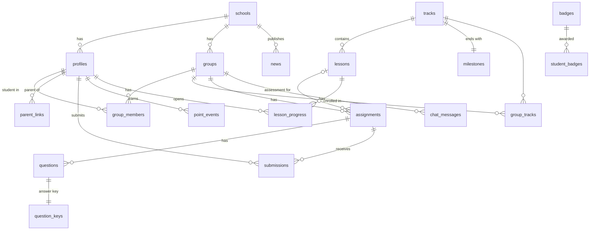

# CMind database (Supabase / Postgres)

Schema, Row Level Security, points rules and storage policies for the CMind LMS.
Everything a user can read or write is decided **here**, not in the frontend.

## Layout

```
migrations/     Ordered SQL migrations (Supabase CLI format). Never edit one after it ran in production; add a new one.
seed.sql        Demo curriculum (4 tracks) for local/staging. Re-runnable.
integration/    Tests on plain Postgres: a test-only Supabase shim + 26 RLS and points tests.
```

## Roles

| Role | Scope | Can |
|---|---|---|
| `super_admin` | All schools (CMind staff) | Manage schools, global curriculum, badges, default point rules |
| `school_admin` | One school | Manage groups, enrollments, news, points of their students, school point rules |
| `instructor` | Their groups | Assignments, questions, grading, chat moderation |
| `student` | Their groups | Open lessons, submit work, chat, see own points/badges |
| `parent` | Linked children | Read-only: children's work, points, progress |

Role and school live in `profiles` and are changed only by the API with the service role.
A suspended school (`schools.status`) locks out all of its users.

## Points rules (enforced in SQL)

| Event | Points | Function |
|---|---|---|
| First open of a video | +5 (school can change) | `open_lesson(lesson_id)` |
| First open of an article | +5 | `open_lesson(lesson_id)` |
| Graded 100% and submitted on or before the deadline | +10 | `submit_assignment` (MCQ, auto-graded) / `grade_submission` (upload) |
| Manual adjustment with a reason | any, ±1000 | `adjust_points` (school admin) |

- `point_events` is an append-only ledger. Students and instructors cannot write it; events are revoked, never deleted (`revoke_point_event`).
- A unique index guarantees each automatic award happens once, even under concurrent requests.
- Regrading below 100 revokes the bonus; regrading back to 100 restores it.
- Displayed totals (`student_points` view) never go below 0. Badges are permanent once earned.
- Every grade, adjustment, revoke and rule change is written to `audit_logs`.

## Tables

| Area | Tables |
|---|---|
| Core | `schools`, `profiles`, `groups`, `group_members`, `parent_links`, `audit_logs` |
| Curriculum | `tracks`, `lessons` (video / article / assessment), `milestones`, `group_tracks` |
| Assessments | `assignments`, `questions`, `question_keys` (staff only), `submissions` |
| Gamification | `point_rules`, `point_events`, `lesson_progress`, `badges`, `student_badges` |
| Communication | `chat_messages`, `news`, `notifications` |
| Views | `student_points`, `track_progress` (both respect the caller's RLS) |



## Storage

All buckets are private (signed URLs). Students upload to
`submissions/{school_id}/{student_id}/{assignment_id}/{file}` and cannot overwrite after uploading.
Lesson assets are written by super admins only. Avatars live in `avatars/{user_id}/`.

## Run the tests

Needs any Postgres 15+ you can create databases on:

```bash
DATABASE_URL=postgres://postgres@localhost:5432/postgres npm run test:db
```

The test creates a throwaway database, applies `integration/00_supabase_shim.sql` (test only, never run it on Supabase),
all migrations and the seed, runs the suite, and drops the database. CI does the same on every PR.

## Apply to Supabase

```bash
npx supabase login
npx supabase link --project-ref <your-project-ref>
npx supabase db push          # applies migrations/
# staging only: load demo curriculum
psql "$STAGING_DB_URL" -f supabase/seed.sql
```

## Rules for future migrations

- Every new table: `school_id` if school-scoped, `enable row level security`, explicit policies, and a test.
- Supabase grants new `public` tables to `anon`: revoke in the same migration.
- Security-definer functions: `set search_path = ''` and fully qualified names.
- Call table-returning functions as `select * from fn(...)`, never `select (fn(...)).*` (runs the function once per column).
